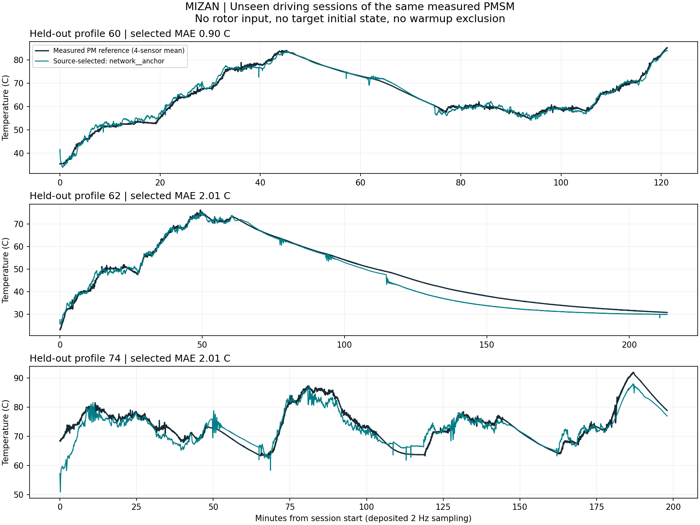

# MIZAN Motor Temperature

A causal virtual sensor for the recorded permanent-magnet temperature channel of a PMSM. Seven online measurements feed a trained model through thermal-history features. The repository includes frozen JSON weights, a Python standard-library inference package, classical baselines, and the original benchmark results.

**Recorded test result:** 1.641 °C mean absolute error averaged equally over three held-out driving sessions. These are sessions of one motor. The separately frozen SVR + Ridge baseline achieved 1.609 °C, so the experiment does not establish neural-network superiority.



## Quick start

Python 3.10 or newer. Inference has no third-party runtime dependencies.

```bash
git clone https://github.com/canblmz1/mizan-motor-temperature.git
cd mizan-motor-temperature
python -m pip install -e .
python -m mizan_motor predict --model models/p17.json --input examples/telemetry.csv --output predictions.csv
python scripts/verify_release.py
```

The example contains the first 12 recorded samples of each previously evaluated test session. It checks software agreement with saved predictions; it is not a new accuracy test. The full dataset is downloaded separately from its publisher.

```python
from mizan_motor import MotorTemperatureEstimator

estimator = MotorTemperatureEstimator("models/p17.json")
temperature_c = estimator.step({
    "ambient": 20.0,
    "coolant": 25.0,
    "u_d": 0.0,
    "u_q": 100.0,
    "i_d": 0.0,
    "i_q": 30.0,
    "motor_speed": 1500.0,
})
estimator.reset()  # Start a different recording with a new history.
```

## Input contract

| Channel | Unit |
|---|---|
| `ambient`, `coolant` | °C |
| `u_d`, `u_q` | V |
| `i_d`, `i_q` | A |
| `motor_speed` | rpm |

Samples must be in chronological order at the recorded **2 Hz** rate. A history belongs to one continuous session; reset it at a new session. The CSV CLI resets when the optional `session_id` column changes. Rotor/stator temperatures, torque, future samples, and session identity are excluded from the predictor. Arbitrary sampling rates and missing time intervals are outside the released model contract.

## Recorded benchmark

Training: 63 sessions. Validation: sessions 4, 11, 32. Test: sessions 60, 62, 74; **63,904 rows**, with all startup and high-error rows retained. Model and family selection preceded numerical test parsing.

| Frozen method | Test session-macro MAE, °C |
|---|---:|
| Selected neural ensemble, `p17` | 1.641 |
| Validation-selected EWMA Ridge, `p06` | 2.298 |
| Separately frozen SVR + Ridge | 1.609 |
| Separately frozen direct SVR | 1.658 |
| Constant-coefficient thermal RC, `p20` | 5.235 |

The selected model's pooled MAE is 1.758 °C; its largest underestimation is **17.536 °C** at startup. Session-macro and pooled metrics have different weights. [Full method table](results/all-methods.csv), [structured scores](results/benchmark.json), and [model card](docs/model-card.md) explain the experiment and its limits.

## Repository contents

- `src/mizan_motor/`: validated streaming API and CSV CLI.
- `models/`: unchanged trained neural, Ridge, and RC JSON weights.
- `examples/`: small attributed telemetry and frozen regression fixtures.
- `results/`: recorded scores and compressed reference/prediction rows.
- `research/`: optional standalone reference training/evaluation recipe; it is never run by installation or inference.
- `tests/`: API, session-reset, validation, and CLI contract tests.

```bash
python -m unittest discover -s tests -v
```

The publication cleanup does not retrain the models. Reference training has additional optional dependencies and its own [instructions and reproduction limits](research/README.md). No automatic downloads, training, or GitHub Actions are configured.

## Scope and attribution

This is an engineering implementation of established thermal-history and regression methods. The target is the dataset's recorded magnet reference, described by its authors as an average of surface sensors. It is not a whole-rotor maximum. Evidence covers this test bench; cross-motor transfer and a production control threshold remain unverified.

Data: Wilhelm Kirchgässner, Oliver Wallscheid, Joachim Böcker, [Electric Motor Temperature, version 3](https://www.kaggle.com/datasets/wkirgsn/electric-motor-temperature), [DOI](https://doi.org/10.34740/KAGGLE/DSV/2161054). Method background: [Thermal Neural Networks](https://doi.org/10.1016/j.engappai.2022.105537), [EWMA thermal modeling](https://doi.org/10.1109/ISIE.2019.8781195), and [supervised motor-temperature benchmark](https://doi.org/10.1109/TEC.2021.3052546).

Code: [Apache-2.0](LICENSE). Included weights and data-derived artifacts: [CC BY-SA 4.0](DATA_LICENSE.md). See [provenance](docs/provenance.json) for the original source commit, dataset fingerprint, and frozen-file digests. [Türkçe açıklama](docs/README_TR.md).
